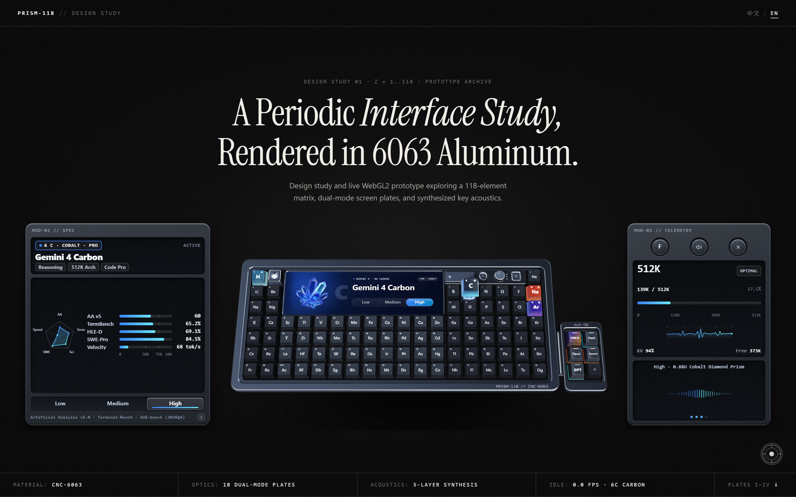
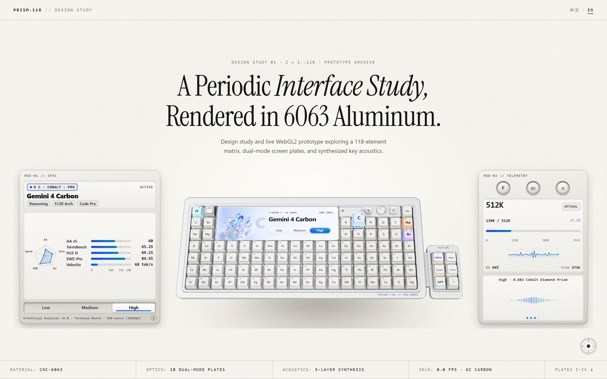
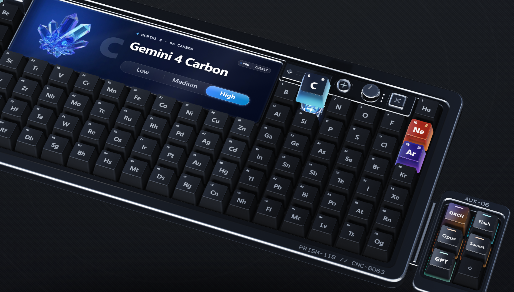
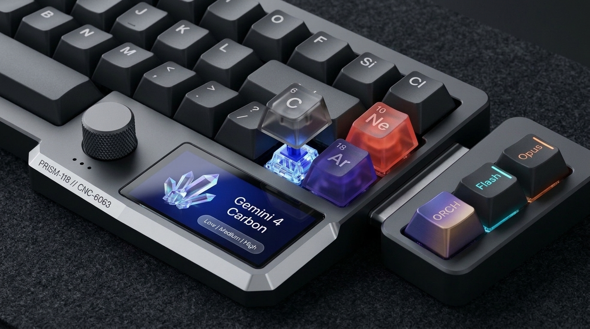
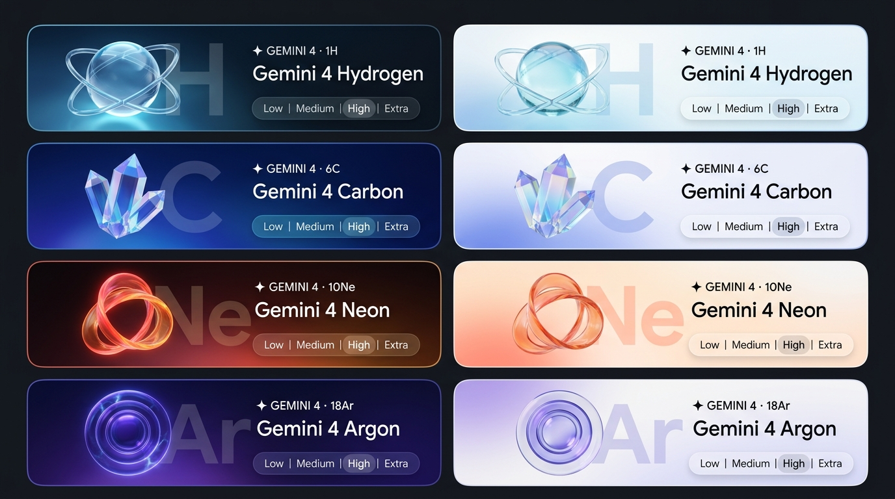
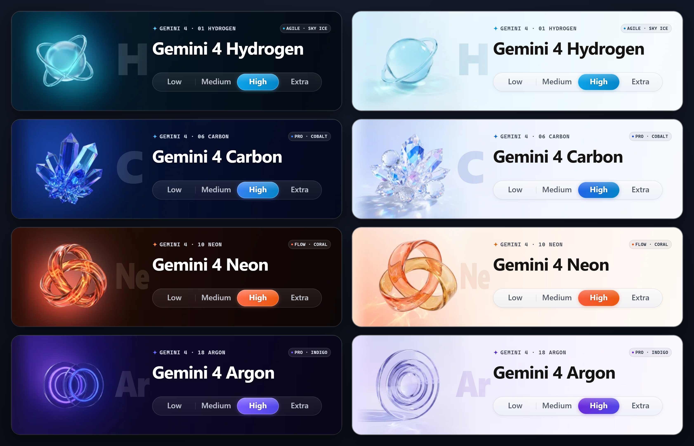
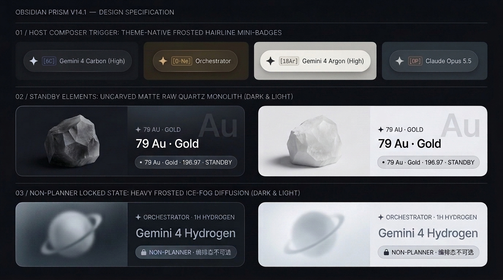
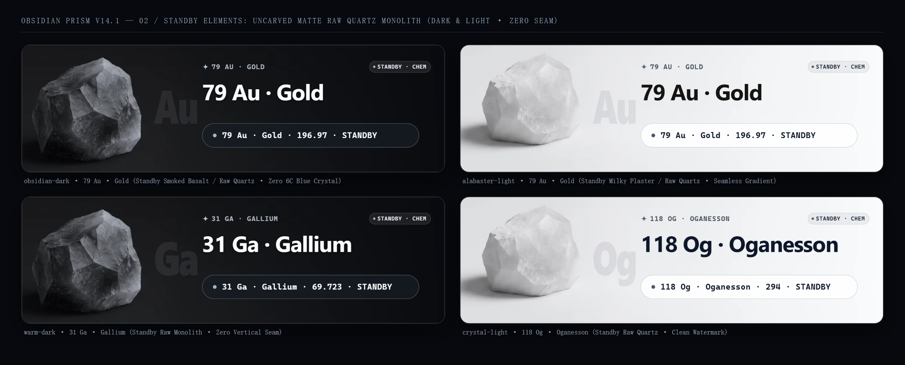
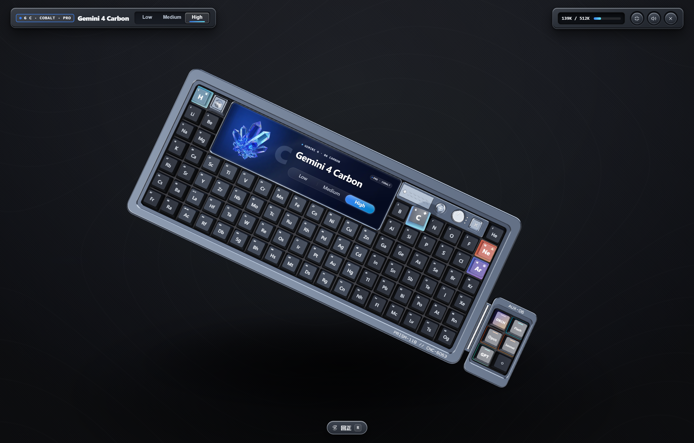

<div align="center">

# PRISM-118 · Periodic Console

**Periodic-Table Keyboard Interface & Optical Design Study Archive**

[**English**](./README.md) · [**简体中文**](./README.zh-CN.md) · [**Design Notes (EN)**](./docs/DESIGN-WHITEPAPER.md) · [**设计笔记（中文）**](./docs/DESIGN-WHITEPAPER.zh-CN.md)



> **This repository** archives and presents the visual studies, dual-mode screen plates, and interactive WebGL2 prototype for **PRISM-118** (a concept interface study created for [Obsidian Prism](https://github.com/RMvdesi/obsidian-prism)).  
> Published strictly as a design study archive (`All Rights Reserved © 2026 RMvdesi`), not as a commercial product release or general-purpose library.

</div>

---

## About This Repository

This repository documents the concept explorations, color calibration, and live WebGL2 interactive prototype for the **PRISM-118** periodic-table keyboard interface, kept as a standalone design study archive.

Built without external 3D frameworks (native WebGL2 GLSL ES 3.0 + Canvas2D + Web Audio API), the prototype renders smoked sea-glass and pastel ice-jade keycaps, transparent switch stems, `1600×480` dark/daylight display plates, and five-layer synthesized key acoustics.



---

## Design Study Preview Page (`index.html`)

The root [`index.html`](./index.html) is a zero-build static preview pairing serif typography with a Swiss `1px` hairline grid across a **Prologue · Plate I–IV · Colophon** layout:

- **Two Gallery Themes & Four Material Palettes**: Toggle between **Gallery Noir** (`Obsidian`, `Warm`) and **Paper Monograph** (`Alabaster`, `Crystal`), five rim accents (`Follow`, `Cobalt`, `Iris`, `Amber`, `Mono`), and prototype controls (`In-Flow View`, `360°` Fullscreen `F`, `3D Tour`, `#0 Orch Dual`, `Reset Orbit (R)` / narrow-viewport `Flip Spec Card`, `512K` telemetry presets `27%`/`54%`/`84%`, and `Toggle 3D Prototype`) via the bottom-right **`Atelier Light`** disc.
- **Bundled Offline Serif & Bilingual Toggle**: Includes local **`Instrument Serif`** WOFF2 files (SIL OFL 1.1, [`assets/fonts/OFL-INSTRUMENT-SERIF.txt`](./assets/fonts/OFL-INSTRUMENT-SERIF.txt)) and progressively loads **`Noto Serif SC`** on `http(s)` for bilingual **`中文 / EN`** reading, under a minimal `1px` header showing only the study code and language switch.
- **Zero-Build `http://` & Offline `file://` Viewing**: Strict CSP compliant (zero inline event handlers) with zero required network calls when opened offline:
  - **GitHub Pages**: Static workflow included in [`.github/workflows/pages.yml`](./.github/workflows/pages.yml).
  - **Local `http://` or Offline `file://`**:
    ```bash
    npx serve .
    # or open index.html directly via file:// in a WebGL2-capable browser
    ```

### Page Sections (Prologue · Plate I–IV · Colophon)
1. **Act 00 · Prologue — Live 3D Prototype**: An unframed single persistent WebGL2 triptych prototype above a `1px` specification index bar (`CNC-6063`, `18 Dual-Mode Plates`, `5-Layer Synthesis`, live `0.0 FPS` idle readout):
   - **`MOD-01 // SPEC`**: Five-axis radar with hover comparison overlays, signed delta tags, and a 180° flip reverse view.
   - **`PRISM-118 // CNC-6063` + Magnetic `AUX-06`**: `18×7` periodic layout (`90` physical slots mapping all `118` IUPAC elements: `4` active keys + `86` physical blind keys representing `114` standby elements such as `79 Au`) + `2×3` side pad featuring the `-0.135U` latching **`#0 ORCH`** switch (dual-core routing topology and `16px` frosted blur on non-planners).
   - **`MOD-02 // TELEMETRY`**: Three circular controls (`F` Fullscreen, Mute, Close) + live `512K` (`524,288` tokens) context gauge and dual-core routing view.
   - **`360°` Fullscreen Inspection (`F`)**: Full-viewport `0.0046 rad/px` drag rotation, `50ms` viscous damping, spring-damped `R` reset, and `Escape` return to the embedded Prologue view.
2. **Plate I // Concept & Prototype**: Static 1:1 Swiss-grid diptychs (zero obscuring sliders) and 3.5× macro renders comparing early concept explorations against live GLSL ES 3.0 output.
3. **Plate II // Chromatic Plates**: Five-band chromatic ruler (`1H`, `6C`, `10Ne`, `18Ar`, `#0 Orch`) and 18 dual-mode `1600×480` plates (`9` dark + `9` daylight: `16` active theme plates + `2` raw-quartz standby plates covering all `114` unassigned elements), plus `#0 Orch` `16px` frosted blur.
4. **Plate III // Acoustics & Constraints**: 6-cell rendering budget summary (`5 Programs / 10 Shaders / 4 VAOs`, `5 Textures + 1 2048px Shadow FBO`, `0.0 FPS` idle halt, `120ms` pre-warm, `90s` dual eviction, `0` hot-path reflows) paired with a logarithmic 5-layer acoustic envelope diagram and 6 clickable Web Audio audition points (`Lift`, `Step`, `Slam`, `Ratchet`, `Latch`, `Blind`).
5. **Plate IV // In-Flow Interaction**: Synchronized with the single Prologue WebGL2 instance (`GPU 01/01`) via a frameless `1px` cursor-line input — test non-modal typing (`f`, `r`, `Space`, `Enter`), `<110ms` short-click menu, theme-native `1px` hairline mini-badge (`6C` / `0·6C` / `18Ar` / `OP`), and `420ms` press-and-hold radial ring (`110ms` cue, `120ms` pre-warm).
6. **Colophon**: Archive note, technical constraints bar, links to design notes / license / citation metadata, and a **collapsed-by-default prototype structure drawer**.



---

## Concept Studies vs. Live WebGL2 Prototype

Plate I places early concept explorations ([`assets/concepts/`](./assets/concepts/)) side-by-side with live WebGL2 renders ([`assets/renders/`](./assets/renders/)):

| Concept Study | Live WebGL2 Render |
| :---: | :---: |
|  |  |
|  |  |
|  |  |

---

## Prototype Module Layout

| Module | Path | Notes |
| :--- | :--- | :--- |
| **PBR Grain & Screen Plates** | [`src/pbr-grain-assets.js`](./src/pbr-grain-assets.js) | `128×128 RG8` anodized/PBT grain normals, `128×64 RGB8` metal reflection map, and 18 dark/daylight WebP plates with `90s` idle eviction. |
| **Dual-Mode 1600×480 Display** | [`src/oled-cyber-screen.js`](./src/oled-cyber-screen.js) | Dark/daylight plates, `79 Au` raw-quartz standby state, `#0 Orch` `16px` frosted blur, and `200ms` cross-dissolve to `0fps`. |
| **WebGL2 PBR Renderer** | [`src/keyboard-3d-gl.js`](./src/keyboard-3d-gl.js) | Bounded at `5 programs / 10 shaders / 4 VAOs / 5 textures / 1 Shadow FBO (2048px)`, smoked glass & ice-jade keycaps, `< 180`-frame `0fps` sleep. |
| **Interactive Prototype Mount** | [`src/periodic-console.js`](./src/periodic-console.js) | Dependency-free mount helper (`PrismPeriodicConsole.mount(options)`), 5-layer Web Audio acoustics, `0` hot-path sync reflows, and symmetric `destroy()`. |



---

## Verification Suite

Run the 11 zero-dependency verification checks (functional regressions, link integrity, and privacy audit) via Node.js (`>= 18`):

```bash
npm test
```

---

## Attribution & License

- **Scope**: This repository serves strictly as a design study and interactive prototype archive.
- **Authorship & Related Project**: Design study created by [RMvdesi](https://github.com/RMvdesi), associated with [Obsidian Prism](https://github.com/RMvdesi/obsidian-prism).
- **License**: All original design studies, renders, shaders, and prototype code in this repository are governed by **`All Rights Reserved © 2026 RMvdesi`** (not open-source and independent of any GPL-3.0 terms in separate repositories) — see [`LICENSE`](./LICENSE) and [`CITATION.cff`](./CITATION.cff). Online viewing, personal local preview, and non-commercial attributed editorial references are permitted; unauthorized copying, redistribution, commercial use, AI dataset ingestion, or derivative porting is prohibited.
- **Third-Party Font Notice**: Bundled `Instrument Serif` WOFF2 font files under [`assets/fonts/`](./assets/fonts/OFL-INSTRUMENT-SERIF.txt) belong to The Instrument Serif Project Authors and are licensed independently under the **SIL Open Font License 1.1** (excluded from the proprietary terms above).
