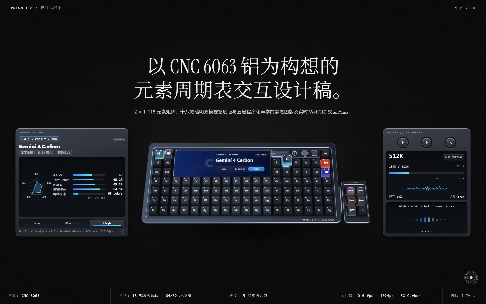
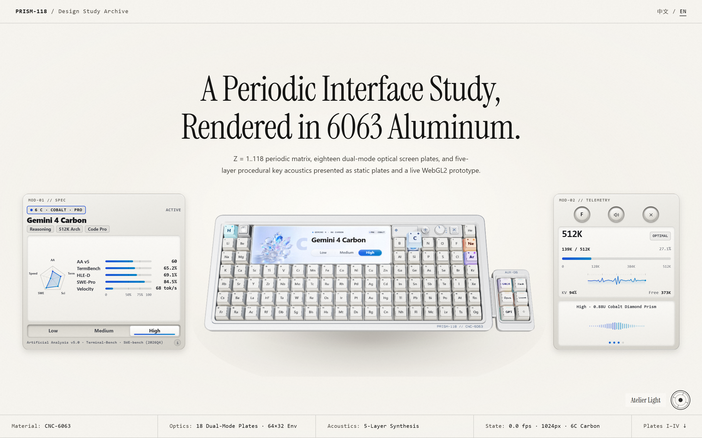
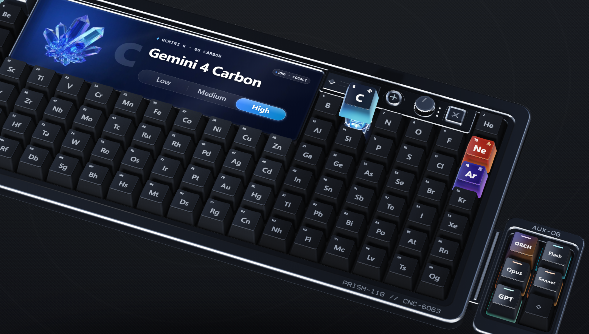
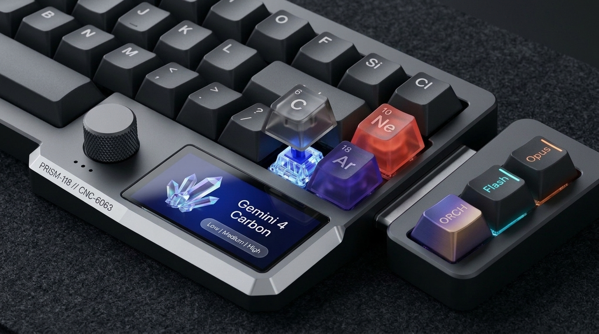
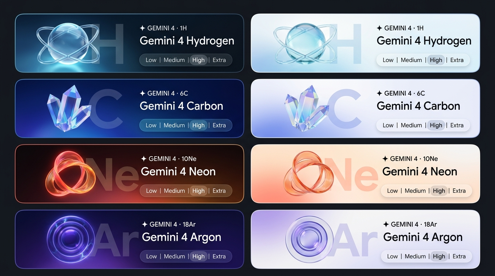
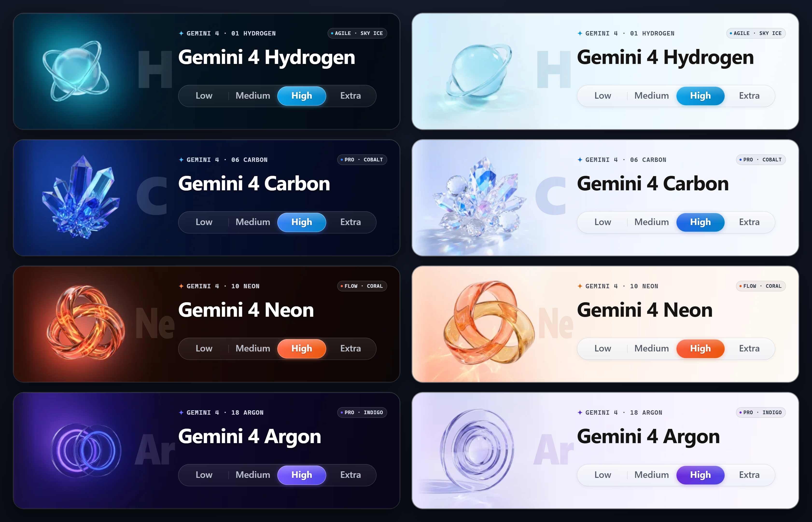
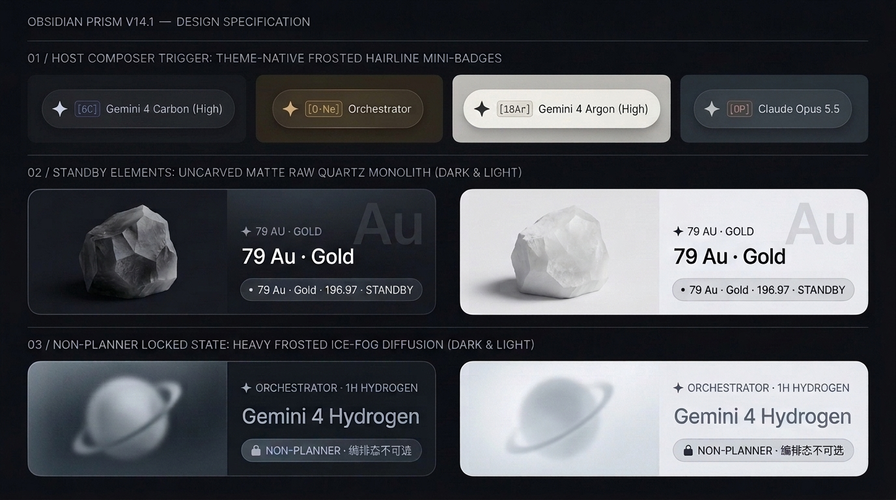
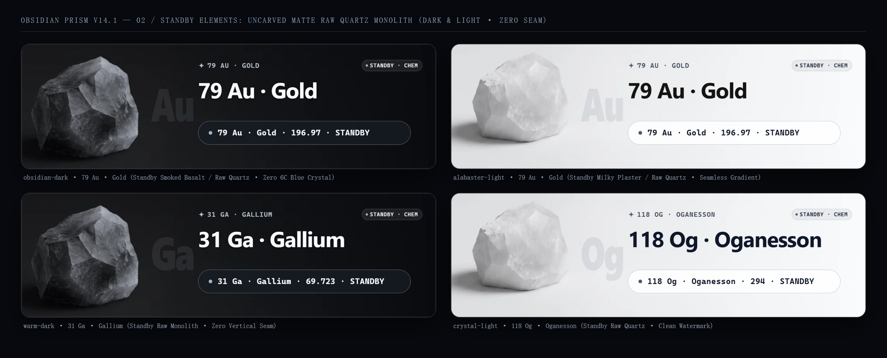
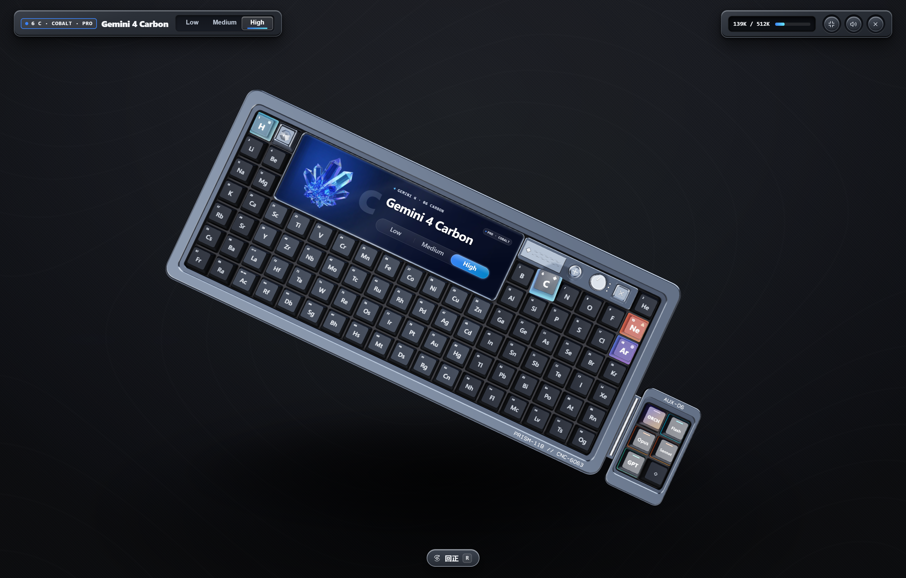

<div align="center">

# PRISM-118 · Periodic Console

**元素周期表形态交互与光学设计稿档案**

[**简体中文**](./README.zh-CN.md) · [**English**](./README.md) · [**设计笔记（中文）**](./docs/DESIGN-WHITEPAPER.zh-CN.md) · [**Design Notes (EN)**](./docs/DESIGN-WHITEPAPER.md)



> **本仓库**用于归档与展示 **PRISM-118** 的视觉草图、双模光学底版与实时 WebGL2 交互设计稿（为 [Obsidian Prism](https://github.com/RMvdesi/obsidian-prism) 创作的界面概念方案）。  
> 仅作设计稿展示、交互原型查阅与原创留存（`All Rights Reserved © 2026 RMvdesi`），不作商业化发布或组件推广。

</div>

---

## 本仓库说明

本仓库收录 **PRISM-118** 周期表形态机械键盘界面的前期概念稿、色彩设定与可交互 WebGL2 原型代码，旨在以独立设计稿档案的形式记录该方案的形态、材质与人因交互细节。

原型在无外部 3D 库依赖的前提下（原生 WebGL2 GLSL ES 3.0 + Canvas2D + Web Audio API）实现了半透海玻璃 / 冰翡玉键帽、透明水晶轴座、`1600×480` 深/浅双模视窗底版以及 5 层程序化按键声学反馈。



---

## 本地与在线设计稿预览页（`index.html`）

根目录 [`index.html`](./index.html) 为零构建静态设计稿预览页，采用衬线排印、无框色阶分层（Tonal Elevation）与 APCA 感知对比度校准的**「序幕交互原型（Prologue）+ 图版 I–IV（Plate I–IV）+ 归档尾页（Colophon）」**结构：

- **双展厅模式、四套材质配色与性能档位**：通过右下角悬浮 **`Atelier Light`** 圆盘切换 **Gallery Noir** 深色模式（`Obsidian` / `Warm`）与 **Paper Monograph** 浅色纸本模式（`Alabaster` / `Crystal`）、五档边缘追光色调（`Follow` / `Cobalt` / `Iris` / `Amber` / `Mono`）、两档渲染预算（`Balanced · 300Hz / 1024px` 与 `Eco · 60fps / 512px`）以及原型视角操作（内嵌视图、`360°` 全屏、`3D 巡礼`、`#0 Orch` 双核、视角归正 / 窄屏翻转左翼卡、`512K` 遥测预设 `27%`/`54%`/`84%`、收起/展开 3D 原型）。
- **离线字体与双语浏览**：内置 SIL OFL 1.1 开源字体 **`Instrument Serif`**（4 份本地 WOFF2，见 [`assets/fonts/OFL-INSTRUMENT-SERIF.txt`](./assets/fonts/OFL-INSTRUMENT-SERIF.txt)），仅在公开 `https:` 域下渐进加载 **`Noto Serif SC`**，支持 **`中文 / EN`** 实时切换；顶栏仅保留设计稿编号与语言切换。
- **零构建 `http://` 与纯离线 `file://` 浏览**：遵循严格 CSP（零内联事件），纯离线打开零外网请求：
  - **GitHub Pages**：内置 [`.github/workflows/pages.yml`](./.github/workflows/pages.yml) 静态部署配置。
  - **本地或离线查看**：
    ```bash
    npx serve .
    # 或直接在支持 WebGL2 的浏览器中以 file:// 打开 index.html
    ```

### 设计稿页面章节（Prologue · Plate I–IV · Colophon）
1. **Prologue（顶部实时 3D 原型）**：无外框常驻 WebGL2 三联结构原型与底部规格索引条（显示 `0.0 FPS` 静止状态与当前选中元素）：
   - **左翼 `MOD-01 // SPEC`**：五轴参数雷达与悬停双雷达对比，支持 180° 翻转背面遥测视图。
   - **中央 `PRISM-118 // CNC-6063` + 磁吸 `AUX-06`**：`18×7` 化学周期表排布（`90` 个物理键槽映射全部 `118` 种 IUPAC 元素，含 `4` 颗活跃元素键与 `86` 颗物理盲键映射 `114` 种待机元素）+ 右侧 `2×3` 副盘；首键 **`#0 ORCH`** 为 `-0.135U` 自锁开关，切入双核视图并对非规划项施加 `16px` 结霜模糊；点击 `79 Au` 等盲键可查看哑光原石底版与原子量读数。
   - **右翼 `MOD-02 // TELEMETRY`**：三枚圆键（全屏 `F` / 静音 / 收起）+ `512K`（`524,288 tokens`）上下文水位与双核路由视图。
   - **`360°` 全屏检视（按 `F`）**：支持 `0.0046 rad/px` 拖曳旋转、`50ms` 阻尼惯性、`R` 键回正与 `Escape` 返回内嵌视图。
2. **Plate I // Concept & Prototype（概念手稿与实机原型对照）**：采用静态 1:1 无框双联并置与 3.5× 局部微距渲染图，对照前期扩散概念草图与实时 WebGL2 渲染表现。
3. **Plate II // Chromatic Plates（十八幅暗明双模视窗底版）**：列出 `1H` / `6C` / `10Ne` / `18Ar` / `#0 Orch` 五组色度标尺，展示 `18` 幅 `1600×480` 双模底版（深色 `9` 幅 + 浅色 `9` 幅：含 `16` 幅活跃主题底版与 `2` 幅覆盖 `114` 种待机元素的原石底版）以及 `#0 Orch` `16px` 结霜状态。
4. **Plate III // Acoustics & Constraints（五层程序化声学与静息零帧约束）**：列出原型资源上限（`5 Programs / 10 Shaders / 4 VAOs` + `FrameGlobals` UBO、`5 Textures + 1024/512px` 动态阴影 FBO 与 `64×32` 环境反射图、`300Hz` 瞬态解锁 / `Eco 60fps` / `0.0 FPS` 静止停机、`120ms` 预热、`90s` 含字符图集回收、`0` 同步回流），附对数频率包络示意图与 6 处可点击试听点（`Lift` / `Step` / `Slam` / `Ratchet` / `Latch` / `Blind`）。
5. **Plate IV // In-Flow Interaction（非模态内嵌流交互原型）**：整页共用顶部唯一 WebGL2 实例（`GPU 01/01`）；在极简游标输入条中可测试打字不劫持 `f`/`r`/空格/`Enter`、`<110ms` 短按菜单、点击 `1px` 发丝微铭牌（`6C` / `0·6C` / `18Ar` / `OP`）及 `420ms` 长按径向环。
6. **Colophon（归档尾页）**：提供设计稿归档注脚、约束摘要、设计笔记 / 许可 / 引用文件入口，以及**默认折叠**的原型模块与挂载说明抽屉。



---

## 概念草图与实时渲染对照

Plate I 将前期概念探索稿（[`assets/concepts/`](./assets/concepts/)）与实时 WebGL2 渲染图（[`assets/renders/`](./assets/renders/)）静态并排对照：

| 概念草图（Concept） | 实时 WebGL2 渲染（Prototype） |
| :---: | :---: |
|  |  |
|  |  |
|  |  |

---

## 原型脚本结构

| 模块 | 路径 | 说明 |
| :--- | :--- | :--- |
| **材质纹理与底版池** | [`src/pbr-grain-assets.js`](./src/pbr-grain-assets.js) | `128×128 RG8` 喷砂法线、`64×32 RGB8` 环境反射图及 18 张无元数据暗/明双模底版，闲置 `90s` 自动释放。 |
| **程序化声学合成器** | [`src/audio-fx.js`](./src/audio-fx.js) | 零音频文件的 5 层 Web Audio 实时物理合成，覆盖 6 类机械交互声效（`Lift` / `Step` / `Slam` / `Ratchet` / `Latch` / `Blind`）。 |
| **周期表矩阵与目录** | [`src/model-catalog.js`](./src/model-catalog.js) | `18×7` 90 槽 118 号 IUPAC 元素坐标、真实原子量、2026Q4 五轴评测数据及主副盘模型映射。 |
| **1600×480 双模视窗** | [`src/oled-cyber-screen.js`](./src/oled-cyber-screen.js) | 暗/明双模底版绘制、`79 Au` 待机原石底版、`#0 Orch` `16px` 结霜模糊、16 项文本裁剪 LRU 与 `targetFps` 限帧。 |
| **WebGL2 PBR 渲染器** | [`src/keyboard-3d-gl.js`](./src/keyboard-3d-gl.js) | 约束在 `5 programs / 10 shaders / 4 VAOs / 5 textures / 1 FBO (1024 / 512px)`，`FrameGlobals` UBO、零三角函数环境采样、`Float64Array` 精确弹簧、`Path2D` 字符图集缓存与回收、`300Hz` 瞬态 / `60fps` Eco 切换及 `< 180` 帧收敛至 `0fps`。 |
| **三联翼舱与独立样式** | [`src/bento-ui.js`](./src/bento-ui.js) | `MOD-01` 五轴幽灵双雷达、`MOD-02` `512K` 遥测与双核拓扑、盲键扫掠去重与独立 `.pp-*` 样式表。 |
| **交互原型挂载总控** | [`src/periodic-console.js`](./src/periodic-console.js) | 零依赖挂载入口（`PrismPeriodicConsole.mount(options)` + `setPerformanceMode`）、Read-then-Write `open()`、rAF 合批缩放、热路径 `0` 同步回流与对称 `destroy()`。 |



---

## 完整性与回归校验

使用 Node.js（`>= 18`）内置 `node:test` 运行全部 11 项原型功能、链接与隐私边界校验：

```bash
npm test
```

---

## 归属与许可

- **仓库性质**：本仓库仅作为设计稿与交互原型归档展示。
- **作者与关联项目**：设计稿由 [RMvdesi](https://github.com/RMvdesi) 创作，对应 [Obsidian Prism](https://github.com/RMvdesi/obsidian-prism) 中的概念方案。
- **许可说明**：本仓库原创设计稿、图文资产与原型代码适用 **`All Rights Reserved © 2026 RMvdesi`**（非开源协议，不适用关联仓库的 GPL-3.0）—— 详见 [`LICENSE`](./LICENSE) 与 [`CITATION.cff`](./CITATION.cff)。允许在线浏览、个人本地打开体验以及保留出处前提下的非商业截图/录屏评述；未经书面授权不得复制、再分发、商用、AI 训练抓取或衍生移植。
- **第三方字体独立许可**：[`assets/fonts/`](./assets/fonts/OFL-INSTRUMENT-SERIF.txt) 中内置的 `Instrument Serif` WOFF2 字体文件归属 The Instrument Serif Project Authors，独立遵循 **SIL Open Font License 1.1**，不受上述专有条款约束。
