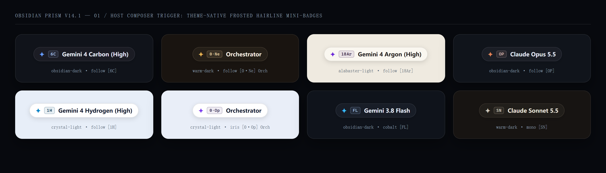
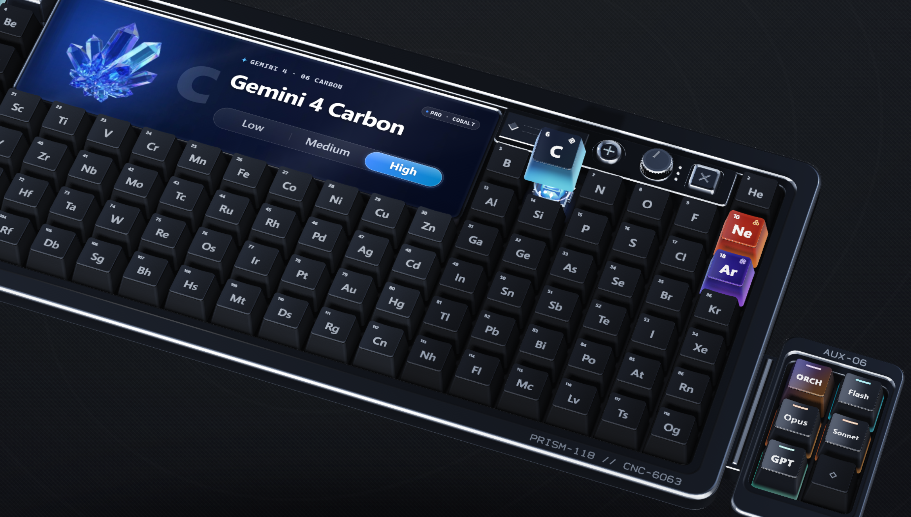
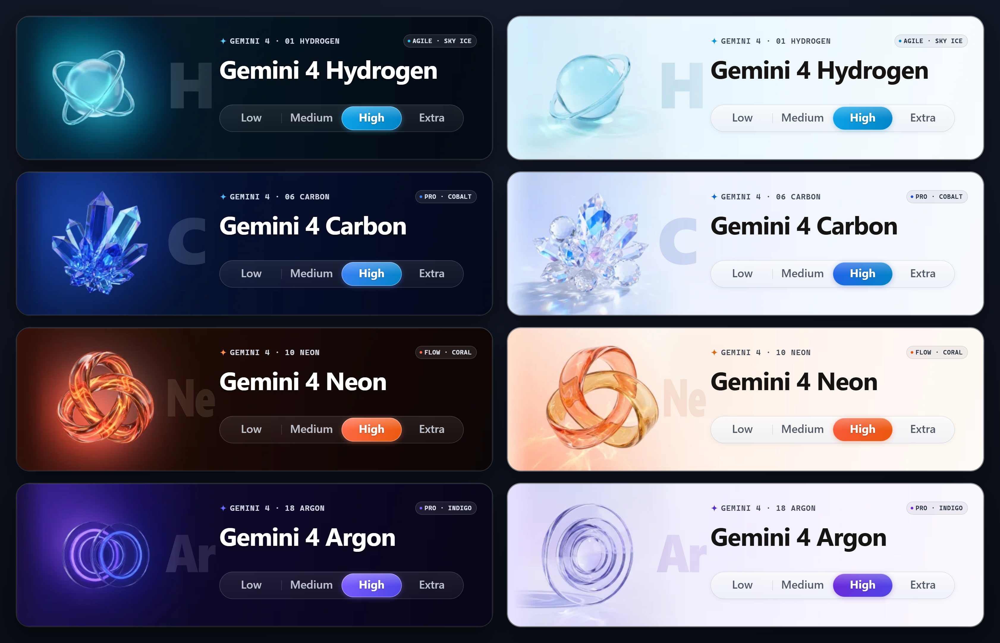

# PRISM-118 // CNC-6063 · Industrial, Optical & WebGL2 Design Notes

> **Design Study Author**: RMvdesi ([https://github.com/RMvdesi](https://github.com/RMvdesi))  
> **Related Project**: Obsidian Prism ([https://github.com/RMvdesi/obsidian-prism](https://github.com/RMvdesi/obsidian-prism))  
> **Archive Note**: Design Study V14.1 · `All Rights Reserved © 2026 RMvdesi` (for design study & prototype reference only)

---

## Contents

1. [Design Thesis & Non-Modal Triptych Ergonomics](#1-design-thesis--non-modal-triptych-ergonomics)
2. [Colourimetry: Four Chassis Kits & Elemental Optical Spectrum](#2-colourimetry-four-chassis-kits--elemental-optical-spectrum)
3. [Hand-Written WebGL2 PBR Pipeline & Sea-Glass / Ice-Jade Physics](#3-hand-written-webgl2-pbr-pipeline--sea-glass--ice-jade-physics)
4. [1600×480 Dual-Mode Full-Bleed Banners & Sealed Visual Semantics](#4-1600480-dual-mode-full-bleed-banners--sealed-visual-semantics)
5. [Concept-to-Silicon: From Diffusion Explorations to Real-Time Execution](#5-concept-to-silicon-from-diffusion-explorations-to-real-time-execution)
6. [5-Layer Procedural Web Audio Acoustics & 0fps Green Lifecycle](#6-5-layer-procedural-web-audio-acoustics--0fps-green-lifecycle)
7. [Prototype Structure & Attribution Note](#7-prototype-structure--attribution-note)

---

## 1. Design Thesis & Non-Modal Triptych Ergonomics

Conventional dropdown menus display model options as a flat text list without surfacing capability trade-offs or preserving workspace context. **PRISM-118** explores an alternative keyboard-inspired CNC-6063 tactile interface anchored non-modally beneath the input row.

### 1.1 Architectural Triptych Topology

| Module | Laser Engraving | Optical & Ergonomic Function |
| :--- | :--- | :--- |
| **Left Wing** | `MOD-01 // SPEC` | Renders 2026Q4 five-axis evaluations (AA v5, TermBench, HLE-D, SWE-Pro, throughput). Hovering any unlocked keycap or thinking effort tier overlays a translucent **Ghost Dual-Radar** polygon with signed deltas, paired with a 180° 3D flip telemetry reverse face. |
| **Center & Magnetic Pad** | `PRISM-118 // CNC-6063` + `AUX-06` | Houses the `18×7` periodic matrix (90 physical slots spanning all 118 elements), an embedded `1600×480` optical glass display, a diamond-knurled rotary encoder knob, and the magnetically bridged `2×3` `AUX-06` pad crowned by the `-0.135U` latching `#0 ORCH` switch. |
| **Right Wing** | `MOD-02 // TELEMETRY` | Features three machined circular controls (Fullscreen `F`, Acoustic Mute, Confirm Close), a live `512K` (`524,288 tokens`) context gauge, KV cache hit rate, and an adaptive bottom bay switching between solo acoustic waves and `#0 Orch` amethyst-gold dual-core routing topology. |

### 1.2 In-Flow Push-Up Ergonomics & Viewport Adaptation

- **Zero Shortcut Hijacking**: While docked in-flow, there is no modal backdrop. Typing `f`, `r`, `Space`, or `Enter` inside any editable input passes through 100% untouched.
- **Responsive Tiering & Short-Window Clamping**:
  - `Wide (>= 1180px)`: Full three-module triptych (`MOD-01` + `PRISM-118 & AUX-06` + `MOD-02`);
  - `Medium (960px – 1179px)`: Folds right-wing telemetry into a compact header bar while preserving `MOD-01` and the 3D stage;
  - `Narrow (< 960px)`: Condenses side wings into an expandable summary pill;
  - `Short Viewport (< 560px height)`: Dynamically measures composer height and clamps dock height (`172px – 268px`) with zero keycap clipping.

### 1.3 Theme-Native `1px` Hairline Mini-Badges (`.pp-mini-keycap`)

Replacing heavy saturated plastic pills, composer mini-badges use a `1px` translucent hairline border harmonized with the active theme:
- **Direct Elemental Models**: `1H` · `6C` · `10Ne` · `18Ar`
- **Latched `#0 Orch` Dual-Core Planners**: `0·6C` · `0·Ne` · `0·Ar` · `0·Op`
- **Standalone Auxiliary Models**: `OP` (Opus) · `SN` (Sonnet) · `FL` (Flash) · `GP` (GPT-OSS)
- **Dual Invocation**: Clicking the `1px` mini-badge toggles the dock immediately; holding the trigger button spawns a `110ms` radial progress ring, silently pre-warms textures at `120ms`, and pushes open the console at `420ms` while leaving `< 110ms` label clicks untouched.

---

## 2. Colourimetry: Four Chassis Kits & Elemental Optical Spectrum

### 2.1 Four CNC-6063 Anodized & Porcelain Chassis Kits

| Kit ID (`kitId`) | Polarity | Surface Finish | Primary (`Follow`) | Optical Rim Profile (`rimTone`) |
| :--- | :---: | :--- | :---: | :--- |
| **`obsidian-dark`** | Dark | Space-black micro-bead anodized 6063 aluminum + mirror 45° chamfer | `#669DF6` | Cool-White Micro-Dispersion |
| **`warm-dark`** | Dark | Espresso-bronze anodized aluminum + warm champagne bevel | `#D97757` | Warm Bronze-Amber |
| **`crystal-light`** | Light | Cool silver-mist bead-blasted aluminum + ice-white plate | `#2563EB` | Daylight Ice-Silver |
| **`alabaster-light`** | Light | Warm alabaster electrophoresis aluminum + editorial ivory plate | `#B45309` | Alabaster Warm Ivory |

Five optical rim accents (`follow`, `cobalt`, `iris`, `amber`, `mono`) dynamically retune specular edges, with `mono` enforcing strict zero-chroma silver-slate discipline even when `#0 Orch` is latched.

### 2.2 Elemental & Auxiliary Optical Spectrum

| Slot | Model Family | Optical Sculpture Motif | Dark Core Hex | Light Core Hex | Levitation Travel (`Low` → `Extra`) |
| :--- | :--- | :--- | :---: | :---: | :--- |
| **`1 H`** | Gemini 4 Hydrogen | Sky-Ice Dual-Orbit Sphere | `#38BDF8` / `#7DD3FC` | `#0284C7` / `#38BDF8` | `0.42U` → `0.62U` → `0.88U` → `1.05U` |
| **`6 C`** | Gemini 4 Carbon | Royal Cobalt Iridescent Cluster | `#3B82F6` / `#93C5FD` | `#1D4ED8` / `#2563EB` | `0.42U` → `0.62U` → `0.88U` |
| **`10 Ne`** | Gemini 4 Neon | Coral-to-Gold Mobius Torus | `#F97316` / `#FBBF24` | `#EA580C` / `#F59E0B` | `0.42U` → `0.62U` → `0.88U` → `1.05U` |
| **`18 Ar`** | Gemini 4 Argon | Electric Indigo Concentric Lens | `#8B5CF6` / `#C4B5FD` | `#6D28D9` / `#7C3AED` | `0.42U` → `0.62U` → `0.88U` |
| **`AUX #0`** | `#0 Orchestrator` | Nebula Amethyst-Gold Gyroscope | `#A855F7` → `#F59E0B` | `#7E22CE` → `#D97706` | `-0.135U` mechanical latched travel |
| **`AUX #1`** | Gemini 3.8 Flash | Electric Cyan Twin-Prism Wing | `#2DD4BF` / `#5EEAD4` | `#0D9488` / `#14B8A6` | `0.42U` → `0.62U` → `0.88U` |
| **`AUX #2/#3`** | Claude Opus / Sonnet | Terracotta Warm-Amber Arch | `#E07A5F` / `#F4A261` | `#C2410C` / `#EA580C` | `0.42U` → `0.62U` → `0.88U` |
| **`AUX #4`** | GPT-OSS 120B | Silver-Cyan Ice Hexagonal Knot | `#67E8F9` / `#CBD5E1` | `#0E7490` / `#475569` | `0.62U` → `0.88U` |

---

## 3. Hand-Written WebGL2 PBR Pipeline & Sea-Glass / Ice-Jade Physics

### 3.1 Industrial Minimalist Purity (`PRISM-118 // CNC-6063`)

The 3D CNC chassis keeps laser engravings strictly limited to hardware codes (**`PRISM-118 // CNC-6063`** on the lower-right bezel and **`AUX-06`** on the magnetic pad), while design archive attribution (`RMvdesi` / `Obsidian Prism`) stays quiet in the footer fine print and repository docs.

### 3.2 Strict `5 / 10 / 4 / 5 / 1` GPU Resource Budget

Engineered without Three.js or external WebGL wrappers, the renderer enforces a hard GPU ceiling verified by automated unit tests:
- **`5` WebGLPrograms / `10` WebGLShaders**: CNC step-bezel chassis (`progChassis`), instanced sea-glass / PBT keycaps (`progKeycap`), anti-bleed curved glass OLED (`progOled`), air-gap octahedral micro-crystals & knurled hardware (`progSolid`), and orthographic depth shadows (`progShadow`);
- **`4` VAOs** & **`5` VRAM Textures + `1` `2048×2048` Shadow FBO**:
  1. `128×128 RG8` dual-channel procedural PBT & anodized aluminum micro-grain normals;
  2. `128×64 RGB8` studio softbox metal environment reflection map (`24,576 B`);
  3. Crisp vector-rasterized keycap legend atlas;
  4. `1600×480` dual-mode OLED key-art texture;
  5. `2048×2048` soft-shadow depth map.

---

## 4. 1600×480 Dual-Mode Full-Bleed Banners & Sealed Visual Semantics

- **16 Active Dark & Daylight Masterplates**: Each active element and auxiliary family features dedicated dark velvet-night and daylight porcelain-mist `1600×480` refractive glass sculptures seamlessly transitioning into clean typography.
- **2 Dedicated Raw-Quartz Standby Masterplates (`114` Elements)**: Clicking or dwelling on unassigned periodic keys (`79 Au`, `31 Ga`, `118 Og`) displays bespoke **Smoked Basalt (Dark)** and **Milky Plaster Raw Quartz (Light)** monoliths with authentic atomic mass telemetry — never borrowing `6C` blue crystal art.
- **`16px` Heavy Frosted Ice-Fog Seal (`#0 Orch` Non-Planners)**: Non-planner models (`1H`, `Flash`, `Sonnet`) under `#0 Orch` latch diffuse behind a `16px` Gaussian kernel, `48px` edge-bleed guard, and `92%` cold-slate rime-fog veil (with a two-pass `1/4 → 1/12` offscreen bilinear fallback).

---

## 5. Concept-to-Silicon: From Diffusion Explorations to Real-Time Execution

| Dimension | Early Diffusion Concept (`assets/concepts/`) | Real-Time WebGL2 Silicon (`assets/renders/`) |
| :--- | :--- | :--- |
| **Periodic Matrix Fidelity** | Illustrative QWERTY / generic alpha placeholders | Authentic `18×7` 118-element periodic coordinates, atomic numbers, and masses |
| **3D Optics & Stem Mechanics** | Static single-angle macro mood piece (`concept-04`) | Live `360°` free orbit (`0.0046 rad/px` + `50ms` momentum), rotating air-gap micro-crystals, chroma-preserving crystal stems (`render-08`) |
| **Screen & State Completeness** | Static layout sheet (`concept-03` / `concept-05`) | Live `200ms` parallax cross-dissolve, `220ms` frosted pill glide, `79 Au` raw quartz & `16px` ice-fog diffusion (`render-07` / `10` / `11`) |

---

## 6. 5-Layer Procedural Web Audio Acoustics & 0fps Green Lifecycle

- **Zero Audio Samples**: Six distinct mechanical acoustic signatures (Magnetic Ceramic Lift, Ice-Jade Effort Step, `115ms` Bottom-Out Poron Thock Slam, Diamond-Knurled Rotary Ratchet, `#0 Orch` Dual-Stage Latch, and Matte Blind-Key Fidget) are synthesized procedurally via 5 layered Web Audio oscillators and filtered noise bursts.
- **Cold-Start Zero Overhead → `120ms` Pre-Warm → `0fps` Idle → `90s` Dual Eviction**:
  - `0` WebGL contexts and `0` decoded bitmaps prior to invocation;
  - Silent asset pre-warm at `120ms` pointer hold;
  - Strict `< 180`-frame convergence to `0fps` (halting `requestAnimationFrame` completely);
  - Automatic `90s` post-close eviction of both decoded OLED wallpapers and the `88 KB` PBR `TypedArray` grain cache, plus `0` synchronous layout reflows on hover/drag hot paths.

---

## 7. Prototype Structure & Attribution Note

The four scripts in `src/` (`pbr-grain-assets.js`, `oled-cyber-screen.js`, `keyboard-3d-gl.js`, `periodic-console.js`) drive the live design preview (`PrismPeriodicConsole.mount(options)`) with zero external 3D dependencies and symmetric `destroy()` cleanup.

**Attribution & License**:  
This repository archives the `PRISM-118 · Periodic Console` design study created by RMvdesi for Obsidian Prism (`© 2026 RMvdesi · All Rights Reserved`). Online viewing, local demo inspection, and attributed editorial references are permitted; unauthorized copying, redistribution, commercial use, or derivative porting is prohibited. See [LICENSE](../LICENSE).
