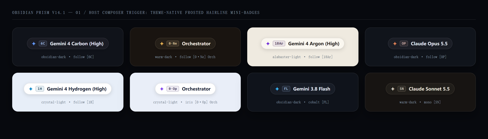
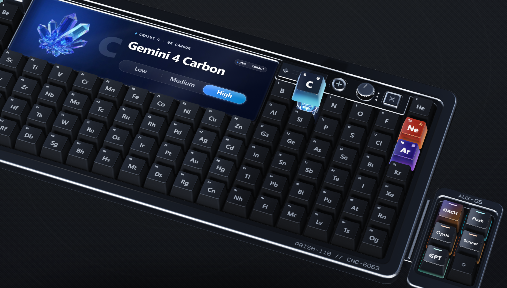
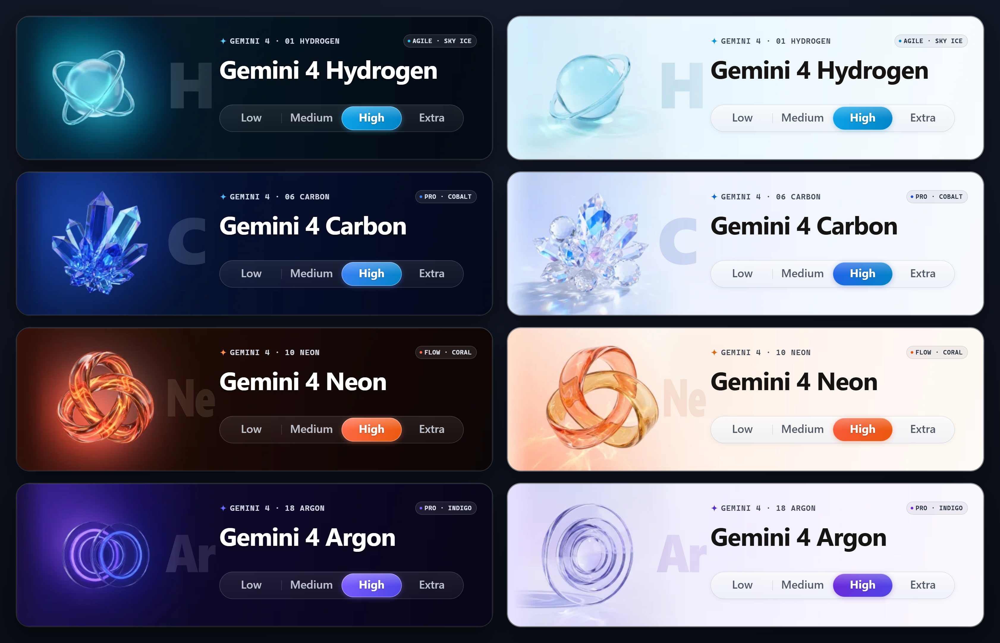

# PRISM-118 // CNC-6063 · 工业、光学与实时 WebGL2 交互设计笔记

> **设计稿作者**：RMvdesi（[https://github.com/RMvdesi](https://github.com/RMvdesi)）  
> **关联项目**：Obsidian Prism（[https://github.com/RMvdesi/obsidian-prism](https://github.com/RMvdesi/obsidian-prism)）  
> **归档说明**：Design Study V14.1 · `All Rights Reserved © 2026 RMvdesi`（仅作设计稿与原型技术记录）

---

## 目录

1. [设计愿景与非模态三联人因拓扑](#1-设计愿景与非模态三联人因拓扑)
2. [色度学标准：四大机身套件与元素光学光谱表](#2-色度学标准四大机身套件与元素光学光谱表)
3. [纯手写 WebGL2 PBR 管线与海玻璃/冰翡玉材质物理](#3-纯手写-webgl2-pbr-管线与海玻璃冰翡玉材质物理)
4. [1600×480 双模满幅光学海报与双层不可选视觉语义](#4-1600480-双模满幅光学海报与双层不可选视觉语义)
5. [概念草图与实时 WebGL2 原型对照](#5-概念草图与实时-webgl2-原型对照)
6. [5 层物理 Web Audio 麻将音合成与 0fps 绿色生命周期](#6-5-层物理-web-audio-麻将音合成与-0fps-绿色生命周期)
7. [原型挂载结构与归属说明](#7-原型挂载结构与归属说明)

---

## 1. 设计愿景与非模态三联人因拓扑

在传统桌面 AI 开发环境中，模型切换往往退化为一串冗长乏味的文本下拉列表：既无法直观感知推理模型在代码、终端、数学与吞吐速率上的能力轮廓，也阻断了沉浸式对话与编码心流。

**PRISM-118** 以客制化 CNC 机械键盘工业设计与精密光学仪器为灵感，确立了三大核心空间与交互准则：

### 1.1 三联仪器拓扑（Triptych Architecture）

| 舱位模块 | 硬件蚀刻标识 | 核心光学与信息职责 |
| :--- | :--- | :--- |
| **左翼评测舱** | `MOD-01 // SPEC` | 承载 2026Q4 五轴能力雷达（AA v5、TermBench、HLE-D、SWE-Pro、吞吐速率）。支持悬停任意键帽或思考力度档位时实时叠绘**幽灵双雷达对比多边形（Ghost Dual-Radar）**与正负差值标签，并可 180° 3D 翻转切换背面深度遥测。 |
| **中央主体与磁吸副盘** | `PRISM-118 // CNC-6063` + `AUX-06` | 主体按真实化学周期表排布 `18×7` 键位（90 槽覆盖全部 118 号元素映射），内嵌 `1600×480` 超宽光学显示屏、钻石滚花无极编码旋钮与物理控制键；右侧磁吸导轨连接 `2×3` `AUX-06` 副盘，首键 `#0 ORCH` 为 `-0.135U` 机械自锁开关。 |
| **右翼遥测舱** | `MOD-02 // TELEMETRY` | 顶部镶嵌三枚 CNC 凹槽圆键（全屏 `F` / 声学静音 / 确认收起），中部实时渲染 `512K`（`524,288 tokens`）上下文水位、KV 缓存命中率与脉搏波形；底部随模式在单核声学频谱与 `#0 Orch` 双核紫金路由拓扑图间无缝切换。 |

### 1.2 非模态「内嵌推升（In-Flow Push-Up）」与自适应视口工程

- **打字与快捷键 100% 零劫持**：底坞展开期间无全屏遮罩，焦点位于任意输入框时，`f`、`r`、`Space`、`Enter` 等按键 100% 原样服务于正常文本输入与消息发送。
- **三档宽度断点与极限矮视口钳制**：
  - `Wide (>= 1180px)`：完整展开 `MOD-01` + `PRISM-118 & AUX-06` + `MOD-02` 三联全景；
  - `Medium (960px – 1179px)`：自动收拢右翼遥测至顶部精简状态条，保留左翼雷达与中央 3D 主体；
  - `Narrow (< 960px)`：折叠双翼为可展开摘要胶囊，优先保障 3D 键盘触控与拾取面积；
  - `Short Viewport (< 560px 窗口高度)`：实时测量上方输入框高度并动态钳制底坞高度（`172px – 268px`），确保上方打字区与下方 7 周期键帽 `0` 像素裁切。

### 1.3 输入框原生共生 `1px` 发丝微铭牌（`.pp-mini-keycap`）

摒弃早期高饱和彩色块与假 3D 塑料底裙，微铭牌采用 `1px` 半透明发丝描边与主题同源微底色，完美融入四大机身主题：
- **元素直连模型**：`1H` · `6C` · `10Ne` · `18Ar`
- **`#0 Orch` 双核编排模型**：`0·6C` · `0·Ne` · `0·Ar` · `0·Op`（直观呈现「编排开关 + 当前主规划核」）
- **副盘常规单模型**：`OP`（Claude Opus）· `SN`（Claude Sonnet）· `FL`（Gemini Flash）· `GP`（GPT-OSS）
- **双模呼出机制**：短按模型文字正常打开轻量快速菜单；直接点击微铭牌秒切底坞开合；按住触发钮 `110ms` 浮现主题渐变径向环、`120ms` 后台静默预热纹理、满 `420ms` 无缝推升展开。

---

## 2. 色度学标准：四大机身套件与元素光学光谱表

### 2.1 四大 CNC 6063 阳极氧化 / 珠光白瓷机身套件

| 套件代号 (`kitId`) | 明暗极性 | 机身表面工艺 | 主强调色 (`Follow`) | 光学边缘调校 (`rimTone`) |
| :--- | :---: | :--- | :---: | :--- |
| **`obsidian-dark`** | Dark | 玄黑微晶阳极喷砂 6063 铝 + 冷白镜面 45° 倒角 | `#669DF6` | 冷白微色散（Cool-White Dispersion） |
| **`warm-dark`** | Dark | 深浓缩咖啡乌木阳极铝 + 暖香槟金微倒角 | `#D97757` | 暖珀微色散（Warm Bronze-Amber） |
| **`crystal-light`** | Light | 冷雾冰晶银喷砂铝 + 清透白冰底板 | `#2563EB` | 冰青日光高光（Daylight Ice-Silver） |
| **`alabaster-light`** | Light | 暖白玉电泳珠光铝 + 象牙米白社论底板 | `#B45309` | 暖玉柔光（Alabaster Warm Ivory） |

同时支持 5 档光学边缘覆盖：`follow`（跟随套件）、`cobalt`（`#669DF6` / `#2563EB`）、`iris`（`#A58AF8` / `#7C3AED`）、`amber`（`#F2B84B` / `#D97706`）、`mono`（消色差铂银 `#D4D7E0` / `#334155`，开启后严格执行零彩度泄漏）。

### 2.2 核心元素与副盘模型光谱矩阵

| 键位槽 | 模型家族 | 光学雕塑母题 | 暗色核心色值 | 浅色核心色值 | 思考档位与悬浮升程 (`Low` → `Extra`) |
| :--- | :--- | :--- | :---: | :---: | :--- |
| **`1 H`** | Gemini 4 Hydrogen | 晴空冰蓝双轨天体球环 | `#38BDF8` / `#7DD3FC` | `#0284C7` / `#38BDF8` | `0.42U` → `0.62U` → `0.88U` → `1.05U` |
| **`6 C`** | Gemini 4 Carbon | 皇家钴蓝虹彩水晶簇 | `#3B82F6` / `#93C5FD` | `#1D4ED8` / `#2563EB` | `0.42U` → `0.62U` → `0.88U` |
| **`10 Ne`** | Gemini 4 Neon | 珊瑚红橙→暖金莫比乌斯环 | `#F97316` / `#FBBF24` | `#EA580C` / `#F59E0B` | `0.42U` → `0.62U` → `0.88U` → `1.05U` |
| **`18 Ar`** | Gemini 4 Argon | 电光靛紫同心光学透镜 | `#8B5CF6` / `#C4B5FD` | `#6D28D9` / `#7C3AED` | `0.42U` → `0.62U` → `0.88U` |
| **`AUX #0`** | `#0 Orchestrator` | 星云紫金陀螺双环（自锁） | `#A855F7` → `#F59E0B` | `#7E22CE` → `#D97706` | `-0.135U` 机械自锁下沉（永不悬浮） |
| **`AUX #1`** | Gemini 3.8 Flash | 电光青双棱光速羽翼 | `#2DD4BF` / `#5EEAD4` | `#0D9488` / `#14B8A6` | `0.42U` → `0.62U` → `0.88U` |
| **`AUX #2/#3`** | Claude Opus / Sonnet | 陶土暖珀折光双拱门 | `#E07A5F` / `#F4A261` | `#C2410C` / `#EA580C` | `0.42U` → `0.62U` → `0.88U` |
| **`AUX #4`** | GPT-OSS 120B | 银青冰晶精密六角结 | `#67E8F9` / `#CBD5E1` | `#0E7490` / `#475569` | `0.62U` → `0.88U` |

---

## 3. 纯手写 WebGL2 PBR 管线与海玻璃/冰翡玉材质物理

### 3.1 硬件级纯粹性原则（`PRISM-118 // CNC-6063`）

在造型约束上，3D 铝镁合金底盘右下角与副盘额头的激光蚀刻保持 **`PRISM-118 // CNC-6063`** 与 **`AUX-06`** 的结构编号，不在 3D 机身上附加广告语或冗余署名；设计稿归属则收束在页尾极小注脚与仓库文档之中。

### 3.2 严格 `5 / 10 / 4 / 5 / 1` WebGL2 资源封顶预算

整套 3D 渲染器零外部依赖，严格锁死以下 GPU 资源上限并通过自动化单测逐项断言：
- **`5` 个 WebGLProgram / `10` 个 WebGLShader**：机身金属与收腰槽（`progChassis`）、实例化半透海玻璃/PBT 键帽（`progKeycap`）、防溢光曲面玻璃 OLED（`progOled`）、磁悬浮全息微晶与滚花配件（`progSolid`）、以及实时正交深度阴影（`progShadow`）；
- **`4` 个 VAO**：高精圆角倒角键帽实例网格、CNC 阶梯双外设机身网格、轴座/微晶几何池、曲面屏网格；
- **`5` 张显存纹理 + `1` 个 `2048×2048` 阴影 FBO**：
  1. `128×128 RG8` 双通道程序化 PBT 咬花与阳极铝喷砂法线颗粒图；
  2. `128×64 RGB8` 摄影棚柔光箱各向异性金属环境反射图（`24,576 B`）；
  3. 键帽高精度矢量抗锯齿字符图集；
  4. `1600×480` 实时合成双模光学屏幕纹理；
  5. `2048×2048` 实时软阴影深度贴图。

---

## 4. 1600×480 双模满幅光学海报与双层不可选视觉语义

### 4.1 18 张暗夜与白昼独立烘焙底图

- **8 组活跃模型 × 暗/明双模（16 张）**：左至中区（`~42%`）为高精烘焙折光光学玻璃雕塑与半透明元素水印，向右自然消融至纯净社论排版区，彻底消除传统分栏竖缝与浅色模式下的违和黑砖屏。
- **114 颗待机化学盲键专属原石坯（2 张）**：当悬停或点击 `79 Au`、`31 Ga`、`118 Og` 等未解锁元素时，展示独立烘焙的**烟熏玄武岩原石（暗）**与**哑光乳白石膏原石（明）**无缝海报，呈现“尚未雕琢成光学透镜的天然矿石晶坯”隐喻。
- **`#0 Orch` 锁定非规划模型重度冰封漫射**：对非规划白名单模型（如 `1H Hydrogen`、`Flash`、`Sonnet`）施加 `16px` 高斯核、`48px` 四边防黑边出血扩展与 `92%` 冷灰去饱和微晶霜雾面纱（并在不支持 `ctx.filter` 的环境自动启用 `1/4 → 1/12` 双级双线性离屏重采样模糊兜底）。

---

## 5. 概念草图与实时 WebGL2 原型对照

以下整理前期概念草图与实时 WebGL2 渲染原型在结构、光学与交互状态上的对照：

| 对比维度 | 早期扩散概念手稿 (`assets/concepts/`) | 实时 WebGL2 代码实拍 (`assets/renders/`) |
| :--- | :--- | :--- |
| **键盘配列真实度** | 概念图仅能生成普通字母键位示意 | 完整构建 90 槽 118 元素真实化学周期表坐标、原子序数与真实原子量 |
| **光学玻璃键帽与晶轴** | 静态单角度微距示意（`concept-04`） | 实时 `360°` 可旋转（`0.0046 rad/px` + `50ms` 惯性）、磁悬浮微晶自转、保彩双色透明晶轴（`render-08`） |
| **双模屏幕与封印态** | 概念排版样张（`concept-03` / `concept-05`） | 实时 `200ms` 视差叠化、`220ms` 毛玻璃胶囊阻尼滑移、`79 Au` 原石坯与 `16px` 冰封漫射（`render-07` / `10` / `11`） |

---

## 6. 5 层物理 Web Audio 麻将音合成与 0fps 绿色生命周期

### 6.1 零音频文件的 5 层实时物理声学管线

通过浏览器原生 `AudioContext` 实时合成 6 类机械交互声效：
1. **磁悬浮陶瓷提拉（Ceramic Lift）**：`165Hz → 310Hz` 正弦上扬谐波 + 气隙微晶泛音；
2. **冰翡玉档位步进（Jade Pebble Step）**：随 `Low / Medium / High / Extra` 音高递进的温润玉石叩击包络；
3. **115ms 确认触底麻将音（Bottom-Out Thock Slam）**：二次点击已悬浮键帽或按 `Enter` 时，键帽极速下压触底，叠加 Poron 底棉低频共鸣（`142Hz → 54Hz`）与厚壁 PBT 空腔音；
4. **钻石滚花旋钮棘轮（Rotary Ratchet）**：滚轮拨动编码器时的精密微齿机械咔哒声；
5. **`#0 Orch` 双段机械自锁（Latch / Unlatch）**：模拟真实自锁开关卡扣咬合与弹起的双瞬态声学反馈；
6. **待机盲键阻尼轻叩（Blind Fidget）**：低通滤波硅胶缓冲闷响，配合 `1000ms` 元素化学信息闪现。

### 6.2 运行资源与静息约束

- **冷启动 `0` 解码**：未呼出底坞时，`0` WebGL 上下文、`0` 壁纸解码、`0` PBR 噪点解码、`0` `AudioContext`；
- **`120ms` 静默预热**：按住触发钮达 `120ms` 时提前解码当前模型底版与 PBR 颗粒，避免展开首帧闪烁；
- **静止即 `0fps`**：所有动效与阻尼弹簧在 `< 180` 帧内收敛并停止 `requestAnimationFrame`；
- **`90s` 缓存回收**：底坞收起（或取消长按）静置满 `90s`，自动清空已解码底版池与 `88 KB` PBR `TypedArray` 缓存，并挂起 `AudioContext`。

---

## 7. 原型挂载结构与归属说明

本仓库 `src/` 目录下的四份原生脚本（`pbr-grain-assets.js`、`oled-cyber-screen.js`、`keyboard-3d-gl.js`、`periodic-console.js`）仅用于驱动设计稿实时预览（`PrismPeriodicConsole.mount(options)`），无外部 3D 库依赖。

**归属与许可**：  
本仓库 `PRISM-118 · Periodic Console` 设计稿由 RMvdesi 创作，关联 Obsidian Prism 概念方案（`© 2026 RMvdesi · All Rights Reserved`）。允许在线阅览、本地体验与保留出处的评述引用；未经授权不得复制、再分发、商用或衍生移植。详见根目录 [LICENSE](../LICENSE)。
